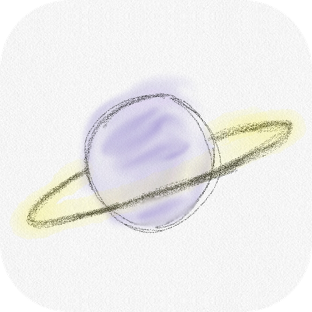

<p align="center">
  
</p>

<h1 align="center">StillLife</h1>
<p align="center"><em>Every note, quietly in orbit.</em></p>

<p align="center">
  <a href="https://github.com/BellaCYC/Still-Life/releases/latest/download/StillLife-Setup.exe"><strong>⬇ Windows</strong></a>
  ·
  <a href="https://github.com/BellaCYC/Still-Life/releases/latest/download/StillLife-Mac.dmg"><strong>⬇ Mac</strong></a>
  ·
  <a href="https://bellacyc.github.io/Still-Life/app/"><strong>iPhone, iPad, Android</strong></a>
  ·
  <a href="https://bellacyc.github.io/Still-Life/">Download page</a>
</p>

---

## Install

**Windows laptop or desktop**
1. Download **StillLife-Setup.exe** (link above) and double-click it.
2. If Windows shows **"Windows protected your PC"**, click **More info → Run anyway**. This is normal for new apps.

**Mac**
1. Download **StillLife-Mac.dmg**, open it and drag StillLife into **Applications**.
2. Open it from Applications. If the Mac says it can't check the developer, go to **System Settings → Privacy & Security** and click **Open Anyway**.

**iPhone and iPad**: open [the StillLife app page](https://bellacyc.github.io/Still-Life/app/) in Safari, tap **Share**, then **Add to Home Screen**.

**Samsung and other Android phones and tablets**: open [the StillLife app page](https://bellacyc.github.io/Still-Life/app/) in Chrome or Samsung Internet, tap **⋮** (or **≡**), then **Install app** or **Add to Home screen**.

On phones and tablets StillLife opens full screen with its own icon and works offline. The island (the pill at the screen edge) is only on Windows and Mac.

## What's inside (version 1.2)

**The island.** A small pill at the edge of your screen. Rest the cursor on it to open your notes on a glass plate; drag it to any edge; switch it off before exams.

**Agendas.** Checklists with labels you name yourself, colours, pins, stars, importance, due dates, and an "All resolved" box that clears a finished list. Blocks, list or details view; sort by date, importance or due date; zoom in on any card.

**Docs, like Google Docs.**
- A template picker for every new doc: plain, lined, college and wide ruled, yellow legal pad, grid, graph paper, dots, Cornell notes, music staff, day planner; paper colours and notebook covers
- Pages or one long pageless page, page breaks
- Document tabs and subtabs with emoji, each with its own outline
- Text styles, fonts (including handwriting fonts), colours, highlight, superscript and subscript, lists, links, pictures, code blocks
- Google Docs keyboard shortcuts (Ctrl+/ shows them all); zoom with a touchpad pinch, Ctrl+scroll or Ctrl + / −
- Grammar suggestions that work offline; find and replace; search across every note
- Special characters and ready-made maths, physics and chemistry equations; typing shortcuts like `\alpha`, `->`, `x^2`, `H_2O`
- Version history with time and computer name, showing what changed; restore any version

**Handwriting, like GoodNotes.** Smooth pressure-sensitive pen, highlighter, eraser (whole stroke or part), lasso to move, resize or recolour, hold-to-snap shapes (lines, arrows, triangles, squares, polygons, circles), stickers and stickers made from your own pictures, a big palette with custom colours and an eyedropper, and paper that grows as you write, downwards and sideways (Paper → Make the paper wider, for timelines and mind maps).

**Code notes, like OneCompiler.** A third kind of note next to Agendas and Docs: write C++, Java, Python, JavaScript, C#, Go, Rust and more with line numbers and colours, give it input, press Run, and save the file.

**Study, like YPT.** A study timer with subjects, a daily goal and a week chart. Create or join a study group with a code: see who is studying right now and for how long today, rankings, chat, and nudges. Strict mode lets your group see if you leave StillLife while your timer runs. Group messages are end-to-end encrypted with the group code.

**Study tools.** Scientific calculator (select a sum and press Alt+= to solve it), translate or look up any word (long-press it), record lectures, take photos.

**Files.** Export to PDF, Word, Markdown, text or a web page; import Word, text, Markdown and pictures (headings become the outline); back up and restore everything.

**Comfort.** English or 繁體中文, date, time and battery in the corner, F11 for full screen, a quick ball for shortcuts, and tabs for docs you have open.

### Good to know

- Your notes stay on the device you write them on. To move them, use **Back up all notes** and import the file on the other device. Translation, the dictionary and running code use free online services (MyMemory, Free Dictionary, Wandbox) and only send what you ask them to. Study groups pass encrypted messages through a free public relay (HiveMQ or Mosquitto); only people with the group code can read them.
- Not in this version, because they need an online account service: signing in with Google, live document collaboration and automatic syncing between devices. Turning handwriting into typed text isn't built in either; on Windows 11 you can write straight into text with a pen.
- The phone and tablet version is a web app, so there is nothing to download from an app store. Running code needs the Wandbox service to accept requests from browsers; if it doesn't, Run works in the Windows and Mac apps.

## For developers

Built with [Tauri 2](https://tauri.app).

```bash
npm install
npm run dev     # run the app locally
npm run build   # build the installer for this computer (Windows or Mac)
```

### Releasing a new version

1. Change `version` in `src-tauri/tauri.conf.json` (and in `package.json` and `src-tauri/Cargo.toml`).
2. Go to **Actions → Release → Run workflow**.
3. A few minutes later the Windows and Mac installers appear under **Releases**, and the download buttons give them to everyone automatically.

The phone and tablet web app lives in `docs/app` and is served by GitHub Pages (Settings → Pages → Deploy from a branch → `main`, `/docs`). The **Web app** workflow copies `ui/` into it whenever `ui/` changes.
